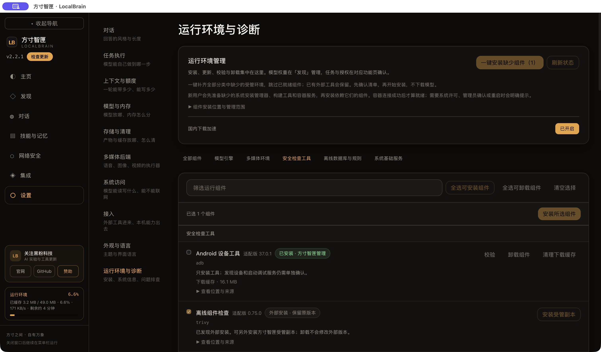
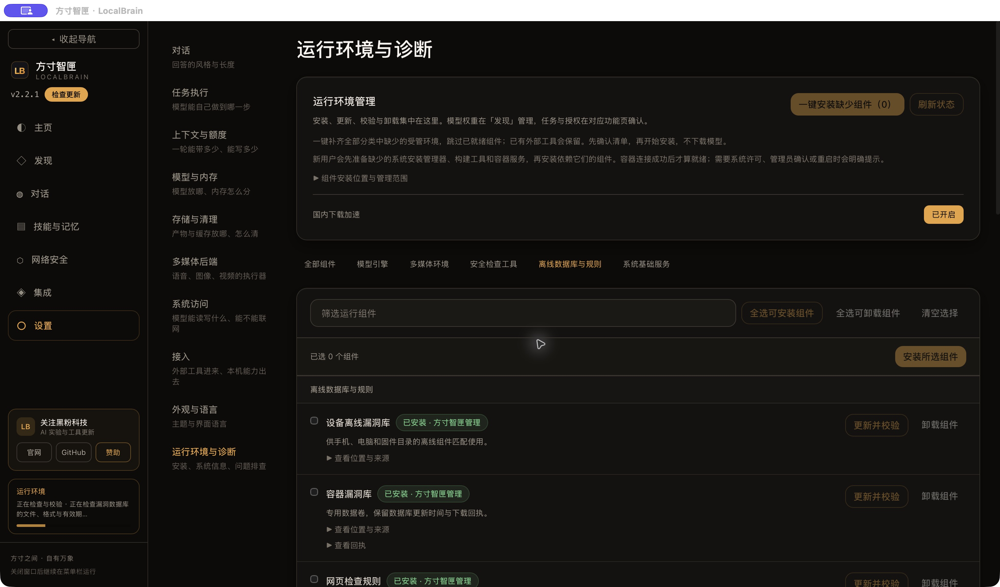
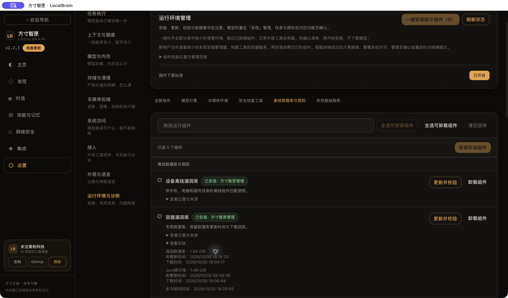
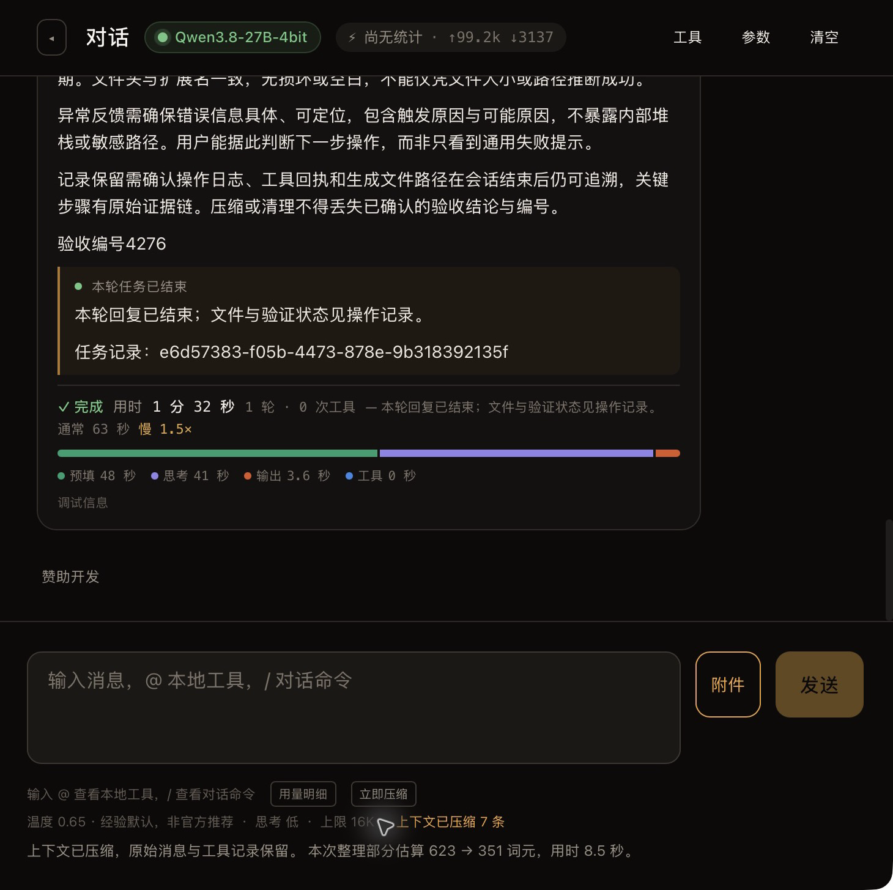
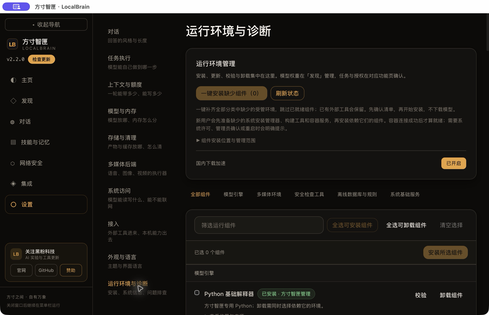

<!-- evergreen:intro:start -->

# LocalBrain · Local AI models, file tools and media workspace

Run supported local models, work with authorized files, and manage speech, image, video and music tasks in one desktop application by HyphenTech. Models plan and call tools; the app retains real execution receipts. Apple Silicon Mac integrates MLX, Metal llama.cpp, Splash and Prism; Windows uses adapted llama.cpp / Prism; Linux is preview support.

<a href="README.md">简体中文</a> | <a href="README.zh-TW.md">繁體中文</a> | <a href="README.en.md">English</a>

 

<!-- evergreen:intro:end -->

<!-- recent-features:start -->
## Recent features and improvements (5 items)

- **2.2.1** · Mac maintenance shows actual stages; percentages require measured download bytes and totals. Completion clears the indicator before refreshing components and database receipts.
- **2.2.0** · Manual compaction uses one engine meter before and after, including summary framing, retaining originals and avoiding completed-tool replay.
- **2.2.0** · Mac, Windows and Linux tools and model capabilities share internal registration while retaining existing entry points and user data; custom plugin installation remains closed.
- **2.2.0** · Mac, Windows and Linux internal module updates validate before activation, defer for active tasks and retain the prior implementation on failure; runtime maintenance remains available.
- **2.1.7** · Windows now recognizes standard Lib/site-packages, fixing false partially-installed image runtime status while preserving existing Torch, Diffusers and models.
<!-- recent-features:end -->

## Mac 2.2.1: maintenance stages and measured download progress

Maintenance no longer stays at a fixed 0%. In Settings → Runtime & Diagnostics, percentages require valid downloaded bytes and a known total. Preparation, extraction, dependency installation, verification and removal show their actual stages. The container database distinguishes the main database and Java index, including freshness checks, valid cache reuse, download sources and commit. Completion clears the busy indicator before refreshing actual state and receipts.

The installed Mac build passed a real 49.0MB tool download and cached container-database maintenance. Download completion automatically changed the component to installed; both valid databases kept their original download times while the latest verification time refreshed. No databases were cleared to force a download, and no large models were downloaded. The Mac app is locally signed and the updater signature was independently verified; it is not Apple-notarized. Windows/Linux remain at 2.2.0 and older releases are retained. See [verification and release boundaries](VERIFICATION-2.2.1-MAC.md).

## Windows / Linux 2.2.0: internal modules and real document calls

Windows and WSL2 Debian are installed at2.2.0; AppImage is available alongside existing Mac2.2.0 packages. Eight tool packages ship with the app; five apply on Windows/Linux and all are ready at1.0.0. Custom plugin UI and installation commands remain closed. Engine, page and runtime registration is shared; compaction uses consistent kernel measurements including summary framing. Windows image runtime detection remains fixed. An existing2B model completed a real request;35 tools across five packaged MCPs matched compatibility schemas, and real DOCX create/read plus Markdown export passed. Model and MCP tests are separate, not an autonomous end-to-end task benchmark. An initial document failure exposed stale build inputs; final packages use the document implementation from the2.2.0 source package. Windows Rust435 passed/36 ignored;2 live module tests passed; TypeScript1638 passed/2 skipped;14 adapters passed;53 DSH tests passed per platform;45 Python files and7 security plus2 packaging tests passed. Linux acceptance is WSL2/Xvfb only. Windows media generation, standalone Harness8K tasks and real HTB remain outside acceptance. Batch CI limits and approval status are recorded; Mac sections below retain their separate test scope.

[Windows/Linux verification](VERIFICATION-2.2.0-WIN-LINUX.md) · [Downloads](https://github.com/HackerChi-Hub/localbrain-releases/releases/tag/v2.2.0)

## Mac 2.2.0: internal modules and consistent context accounting

Publicly released and installed locally on 2026-10-26. The author explicitly authorized this batch's source-CI billing-limit exception. Local checks, signatures and installation verification pass; hosted source CI is not represented as passing.

Eight tool services use internal versioned packages, with shared capability registration for model backends, pages and runtimes. The core retains tasks, authorization, context, skills, memory and user data. Custom plugin installation remains unavailable; existing one-click runtime installation and maintenance remain available. Internal updates validate before activation, defer for active calls and retain the previous implementation on failure.

Manual compaction uses the same engine meter before and after, including summary framing. Originals are retained and completed tools are not replayed. These actual same-source 2.2.0 functional acceptance images are cropped to remove control chrome and unrelated sessions; they do not establish completion of security lab tasks.

Cached models completed representative real chat, document and media calls. Independent web, SSH and local certificate-VPN adapter tests pass. Three native model lab runs timed out without model proof acceptance, model report export or post-repair model retesting; real HTB remains unverified. Experiment materials stay local and are not distributed with the application. See [installation and release verification](VERIFICATION-2.2.0-MAC.md). This batch updates only Mac; Windows/Linux remain at 2.1.7. Older sections below retain historical status; use the platform download table for current releases.

## Windows / Linux 2.1.7: correct Windows image runtime status

A missing Windows Lib/site-packages lookup made verified image environments appear partially installed. This release fixes detection while preserving Linux/macOS layouts, existing runtimes, models, CUDA and drivers. The native Windows package recognizes existing Torch/Diffusers as installed and offers no reinstall action. Both image pipelines and Torchvision import successfully and CUDA is available; actual image generation was not tested. Windows and WSL2 Debian are installed; Debian/AppImage resources and WSL2+Xvfb startup were checked. Mac retains 2.1.6. Source CI billing limits and this batch publication status are recorded in verification; standalone Harness 8K overflow remains unresolved.

[Verification](VERIFICATION-2.1.7-WIN-LINUX.md) · [Windows/Linux downloads](https://github.com/HackerChi-Hub/localbrain-releases/releases/tag/v2.1.7)

## Windows / Linux 2.1.6 released

Windows and WSL2 Debian are installed. This release adds runtime management, download pause/resume and pinned Harness0.2.1-rc.3; Node22.23.3, models and drivers are retained. Native Windows runtime-center rendering and a real read-only PolyStrata35B tool roundtrip passed. Both platforms passed53 DSH tests and old-session recovery without tool replay. Windows Rust:427 passed/34 ignored; TypeScript:1632 passed/2 skipped; adapters:14 passed; all45 Python test files and7 additional security tests passed. All three updater signatures were verified. The author explicitly approved this batch despite source CI billing/spending limits; online source CI is not represented as passing. Linux acceptance is WSL2/Xvfb only; standalone Harness8K overflow and full image/tool task limits remain documented.

[Windows/Linux verification](VERIFICATION-2.1.6-WIN-LINUX.md) · [Known issues](KNOWN-ISSUES-DSH-LOCAL-MODELS.md) · [Downloads](https://github.com/HackerChi-Hub/localbrain-releases/releases/tag/v2.2.0)

Initial Mac and earlier Windows/Linux sections below retain their historical scope; this section and the download table state current platform versions.

## Mac 2.1.6: updated Harness core and clearer runtime maintenance

Mac 2.1.6 is publicly released and installed. Windows/Linux retain published 2.1.3 builds and will be packaged separately by the author. The embedded DSH SDK moves from 0.2.0-rc.2 to the current official prerelease **0.2.1-rc.3**, with exact dependencies and a lockfile. It updates with LocalBrain without changing the standalone Harness client, accounts or existing model configuration.

Ready ordinary components no longer offer an individual install action in Settings → Runtime and diagnostics. Selecting them does not enable batch installation. Missing components can still be prepared together, while offline databases retain explicit update-and-verify actions.

Dependency-blocked Python removal now immediately shows a native explanation listing every unselected dependent; this installed check listed four. The app neither selects extra components nor deletes them automatically. Shared Docker services are detected locally, reused when available, started when offline and installed only when missing. Shared system components retain their existing versions and have no removal action.

The updated skill plugin introduced a working-directory service dependency. The adapter supplies only the host-owned directory identity; tools still return to LocalBrain’s authorized executor. On-demand skills, full opt-out, incremental Chinese summaries and old-session recovery remain available.

The installed app used an existing Splash model for two rounds and one actual read-only security-capability query, returning phase=2 and dockerInstalled=true without scanning a target. Clicking Compact now produced a durable Chinese summary containing trusted user originals and actual receipts while preserving original records. A separate old-SDK session upgrade verified exactly-once tool execution and incomplete-tail recovery. All 53 core tests passed on the bundled Node runtime; 1632 TypeScript and 14 adapter tests passed, with 2 additional tests skipped.

All 13,984 files, permissions and links matched across the build, DMG, updater archive and installed app; application/updater signatures passed and four existing configuration hashes remained unchanged. No models were downloaded and no environments were removed to simulate a new machine. Native button, actual tool-result and compaction terminal-state readback passed. Temporary verification sessions and originals were removed from the regular stores, with evidence retained locally. The Mac app remains locally signed and not Apple-notarized. First-time Mac setup, Windows/Linux and real HTB are outside this round.

The GitHub source documentation job did not start because of account billing/spending restrictions. On 2026-10-25 the author explicitly authorized a Mac 2.1.6 exception based on local checks and the stated verification limits; this is not a remote CI pass.

[Verification and limits](VERIFICATION-2.1.6-MAC.md)。

## Mac 2.1.5: prepare prerequisites and container services together

Mac 2.1.5 is publicly released following packaging, installation and targeted native-interface checks. Windows and Linux retain their published 2.1.3 packages, with new builds handled separately by the author.

Open Settings → Runtime and diagnostics → Install missing components, review the scope and confirm. Missing package managers, build tools and container services are prepared before dependent environments. A failure stops subsequent components; retry fills what is still missing and skips ready items. Containers count as ready only after a successful connection; installed but offline services offer a start action.

Existing local Docker Desktop or Colima services are reused, preserving the default connection, VM resources and running containers. Shared system components have no removal control; Python, FFmpeg, engines and tools retain separate managed environments. On Macs without Homebrew, the app downloads and verifies the official package before handing it to the system installer. Licensing, administrator approval and restarts still require user action.

Downloads can pause with partial files retained and resume explicitly. Extraction, pip and container steps finish the current component before later steps pause. Controls distinguish downloading, resuming and installing a complete cached archive; removal appears only for confirmed installed managed components and cleanup only when cache exists. Built-in document/web tools and the Harness core update with the app without separate maintenance rows.

Native checks covered five component groups, zero missing items, no removal for the three shared dependencies, filtering, selection, installation-scope confirmation and cancellation. Cancellation did not start installation. The build, disk image, updater archive and installed application matched across 12,995 files and links; application and updater signatures passed. Existing-environment reuse and official-installer download/signature/offline-cache checks passed. First-time setup on a Mac without Homebrew and native Windows/Linux system installation remain untested. Existing environments were not removed to simulate a new machine; no models were downloaded or containers stopped.

The Mac app retains local signing and is not Apple-notarized. The GitHub source documentation job did not start because of account billing/spending limits; the author explicitly approved a Mac 2.1.5 release exception. Local checks are not a remote CI pass. See [verification](VERIFICATION-2.1.5-MAC.md) and [prerequisite setup](SYSTEM_PREREQUISITES_2.1.5.md).

[Download Mac 2.2.1 (Apple Silicon DMG)](https://github.com/HackerChi-Hub/localbrain-releases/releases/download/v2.2.1/LocalBrain_2.2.1_aarch64.dmg)

## Historical candidate record: Mac 2.1.4 candidate: one-click runtime setup (pending publication)

The 2026-10-25 candidate adds runtime pause, persisted pending items and explicit continuation, plus Splash pause that preserves original weight fragments. Download, resume, cached installation, removal and cache-cleanup controls follow actual state. Small files and background tasks use real byte units and discard stale speeds on pause. An official approximately 25 MB archive passed exact-offset resumption, full verification, offline reuse and cleanup without downloading a large model. See [usage and verification limits](DOWNLOAD_CONTROLS_2.1.4.md). The independent UI preview below explicitly simulates installation/removal and shows download returning after cache cleanup. Public installers remain at 2.1.3.

Settings → Runtime and diagnostics shows five groups: model engines, media, security tools, offline data and system services. Built-in document/web tools and the Harness core update with the app without maintenance rows. Choose “Install missing components” and review dependencies to fill missing supported components while skipping ready ones. Reconnection rereads and reuses container images/databases; retries process only what is still missing. Individual installation, updates and verification remain available.

Removal controls appear only for confirmed installed managed components, excluding missing, partial, external and unreadable offline states. Batch removal is hidden without eligible selections. Pinned archives preserve interrupted downloads, validate ranges and verify SHA-256 before extraction. Supported existing official package managers prepare system dependencies, preserving system licensing, administrator and restart requirements. Ready services do not show redundant installation instructions.

These use the production component with read-only inventory and explicitly mocked changes. The revision is installed; all 12,995 files/links match and signature/image checks pass. Native capture still fails; native clicks, complete container setup and actual removal remain unverified. See [acceptance limits](VERIFICATION-2.1.4-MAC.md) and [runtime scope](RUNTIME_CENTER.md). Weights, external tools, sessions, reports and VMs remain intact. The Harness core stays on 0.2.0-rc.2. The software package remains unpublished; Windows/Linux remain on 2.1.3.

Windows/Linux 2.1.3 are publicly released: Windows and WSL2 Debian are installed; Debian/AppImage resource checks, packaged DSH initialization, 20-second startup and 53 DSH tests passed. All three updater signatures were verified. The author explicitly approved this batch despite source CI account limits; online source CI is not reported as passing. Bare-metal Linux GPU and full DSH image/tool tasks remain unverified; PolyStrata 35B still overflows its 8K window with the desktop agent. See [acceptance and unresolved items](VERIFICATION-2.1.3-WIN-LINUX.md) and [downloads](https://github.com/HackerChi-Hub/localbrain-releases/releases/tag/v2.2.0). Earlier local-candidate and initial single-platform paragraphs below are historical; this section states current platform status.

## Windows local fixes and DSH integration limits (2026-10-24)

The integration page again has a top-level one-click restore for full Harness integration and managed Codex/Claude Code MCP entries. Each client reports locks, conflicts and missing restore points separately while retaining existing settings. The Windows2.1.3 fix is installed locally; public download versions are shown in the platform table. Linux packages are built and verified separately.

The user has confirmed **basic DSH text usage with Qwen3.8-2B-Distill Q4_K_M**. The live service reports a262144-token window matching the exported configuration. Full-window speed, memory consumption and quality have not been tested, nor does this establish complete tool or multi-turn task compatibility. The current2B endpoint has no vision. Image understanding, MCP image rendering and visual-model integration require separate acceptance.

**The full DSH desktop agent still overflows PolyStrata35B's8K window.** Screenshots show about1.5K system-prompt tokens plus7.4K tool-definition tokens; another request had12728 input tokens. Compressing history or reducing output alone cannot fix an oversized fixed prefix. Reduce task-specific tool overhead or separately test a larger window. Context occupancy does not establish GPU memory exhaustion. The previous short adapter request proved connectivity and routing, not full desktop-agent compatibility.

[Known issues and acceptance scope](https://github.com/HackerChi-Hub/localbrain-releases/blob/main/KNOWN-ISSUES-DSH-LOCAL-MODELS.md). Source GitHub CI remains blocked by account limits; local checks are not represented as online CI success.

<!-- windows-performance:start -->
## Windows 2.0.1: small-context tasks and runtime speed

For local models with 8K contexts, tool schemas load on demand and short spans avoid repeated summarization. Compacted checkpoints add short records from actual tool receipts to help models recognize completed steps. Ordinary requests gain no permanent hint; original records are preserved and users judge the quality of delivered results.

On 2026-10-20, this RTX 4070 Laptop with 8GB VRAM and 32GB RAM ran Qwen3.6-35B-A3B UD Q3_K_M through PolyStrata. Recent logs commonly showed about 75–90 decoded tokens/s, including thinking, rather than visible-text speed. Single-run timings for synthetic read-only tool tasks:

| Scenario | Earlier 2.0.0 | 2.0.1 (historical sample) |
| --- | --- | --- |
| Two tools in one step, no compaction | 8.38 s | 7.91 s |
| Sequential reads with one compaction | No matched comparison | 19.70 s |
| Failure, compaction, retry and completion; two compactions | No matched comparison | 31.66 s |

These are not repeated performance benchmarks. Version 2.0.0 already included some optimizations; these results do not establish a consistent 6% gain over an unoptimized release. Compaction takes time: one recent summary took about 5 s. Avoiding repeated operations may reduce total task time, but that benefit has not been quantified. Five real-model regression scenarios and 47 engine tests passed; this does not guarantee completion of every task or constitute a rerun of the original 12-question evaluation. See [methods and limits](PERFORMANCE-2.0.1-WINDOWS.md).

These are historical samples from 2026-10-20. Use the latest-downloads section for current installers and update manifests.
<!-- windows-performance:end -->

<!-- evergreen:demos:start -->
## ▶ Watch a practical demo

**Starting local models, longer tasks and actual delivery**

| Bilibili | YouTube |
| :---: | :---: |
|  |  |

These videos show the versions available when recorded. Use the current release information on this page for downloads and capabilities. Narration is in Chinese.
<!-- evergreen:demos:end -->

## Latest downloads：Windows 2.2.0 · Mac 2.2.1 · Linux 2.2.0

The following 2.1.3 tool-integration checks are historical.

Mac 2.1.3 restores one-click MCP tools for Codex and Claude Code alongside DeepSeek Harness. OpenCode is not restored. In Integrations, copy, write or undo tools separately for each client. Only LocalBrain tool entries are changed; models, providers, other MCP entries and project settings are preserved. Configuration previews are collapsed by default; new sessions pick up writes. Running desktop clients must be closed after current work finishes; LocalBrain does not terminate them.

Local installation, consistency of 12,995 files and links, app-signature checks and independent updater verification passed. Installed MCP protocol discovery passed 26/26, and a real Codex document-tool call passed. Claude Code testing stopped at the author's request after revoked login credentials returned 401; it is not marked as a passed model-call test. Mac is ad-hoc signed, not Apple-notarized. The GitHub documentation-sync job could not start because of account restrictions; the author explicitly approved this Mac release exception; local passing checks are not passing online CI. [Acceptance and limits](VERIFICATION-2.1.3-MAC.md). Windows/Linux retain 2.1.2 and their existing acceptance records.

The Mac 2.1.2 paragraphs below retain their historical fixes and acceptance records.

Mac 2.1.2 is publicly released: fixes MCP installation on read-only app resources by registering and validating the source path only in the managed Python environment; completed turns show a support text entry, with the QR code opened only on click. The security target list uses the full width; connections and tools are collapsed by default, with forms shown by target and connection type. HTB is no longer advertised as supported. Integration offers DeepSeek Harness only, and short-task timing no longer shows an infinite multiplier. Local regression, targeted installed-app acceptance and consistency of 12,995 files and links passed. GitHub checks could not start because of account payment/spending restrictions; the author explicitly authorized this Mac-only exception. Local passing results are not reported as passing online CI. Windows/Linux 2.1.2 packages are now available; see platform acceptance below. Real HTB end-to-end acceptance, native security execution approval and restart recovery with a pending operation remain unverified. [Acceptance and limits](VERIFICATION-2.1.2-MAC.md).

Mac 1.9.9 repairs download completion and Sushi startup diagnostics, including status polling masking memory errors. Final installed-app checks exercised real preflight rejection, restoring 32K, full-resident loading and a Chinese response. Matched resident/32 GiB exact SSD tests recorded 44.20/31.21 GiB residency. Modes are selected manually and require saving and restarting; no automatic downgrade. See [final installation and test limits](VERIFICATION-1.9.9-MAC.md). Older 1.9.8 paragraphs retain their original verification scope.

2.0.8 adds model-settings path-validation fixes and Web CTF foundations. Six transport tests passed on Windows/Linux, but production isolated-browser, native approval and real-model CTF acceptance remain pending. Execution requires passing local isolation checks. [Mechanism and limits](SECURITY-WEB-CTF.md).

Windows/Linux 2.1.2 now include the bundled-resource registration fix and current UI improvements. Windows native real-model chat, file writing and compacted continuation passed; installed with configuration hash unchanged. Linux Debian/AppImage packaged hosts, resources and WSL2 startup passed; Debian installed. Linux bare-metal/GPU and real HTB are unverified; special engines are not implicitly upgraded. [2.1.2 verification](VERIFICATION-2.1.2-WIN-LINUX.md).

The author approved this Windows/Linux 2.1.2 release exception. The source GitHub check could not start due to account payment/spending restrictions; local passing checks are not passing online CI.

| Platform | Package and status |
| --- | --- |
| Apple Silicon Mac 2.2.1 | [DMG](https://github.com/HackerChi-Hub/localbrain-releases/releases/download/v2.2.1/LocalBrain_2.2.1_aarch64.dmg) · Installed; this batch verified real downloads, maintenance stages and completion refresh; locally signed, not Apple-notarized |
| Windows x64 | [Installer](https://github.com/HackerChi-Hub/localbrain-releases/releases/download/v2.2.0/LocalBrain_2.2.0_x64-setup.exe) · 2.2.0; installed; platform acceptance and limits above|
| Linux x64 | [Debian](https://github.com/HackerChi-Hub/localbrain-releases/releases/download/v2.2.0/LocalBrain_2.2.0_amd64.deb) · [AppImage](https://github.com/HackerChi-Hub/localbrain-releases/releases/download/v2.2.0/LocalBrain_2.2.0_amd64.AppImage) · 2.2.0; installed; platform acceptance and limits above|

[Mac 2.2.1 release notes](https://github.com/HackerChi-Hub/localbrain-releases/releases/tag/v2.2.1) · [Mac checksums](SHA256SUMS-2.2.1-MAC.txt) · [Windows/Linux 2.2.0 release notes](https://github.com/HackerChi-Hub/localbrain-releases/releases/tag/v2.2.0). Drag the Mac app into Applications; on Debian/Ubuntu run `sudo apt install ./LocalBrain_2.2.0_amd64.deb`. Older releases are retained.

The following Windows 2.0.1 and earlier paragraphs retain their original historical status. Current platform versions are listed in the download table above.

This release updates **Windows 2.0.1**: compacted checkpoints append short records from the last three committed tool receipts, without a permanent hint in ordinary requests. After productive compaction, a proactive target may be exceeded only if the full output allowance still fits. Real-model fault injection, explicit redo, failed-tool retry, batching, and final-package chat/search checks passed; installed locally. Summaries remain lossy. See [acceptance and limits](VERIFICATION-2.0.1.md). Mac retains 1.9.9; existing Linux packages are unchanged.

Historical 1.9.1 acceptance notes: See the [1.9.1 verification record](VERIFICATION-1.9.1.md) for context compaction, skills, memory and their tested limits. Originals and summaries are saved separately; recovery does not replay completed tools. Summaries remain lossy and can miss facts. Historical media results and their speech, editing, music and experimental-video issues remain in the [1.8.0 verification record](VERIFICATION-1.8.0.md). Windows and Linux Debian 1.9.1 packages were added on 2026-10-17 from the same main-branch commit with the native tool engine enabled. Windows package and updater-signature checks passed; Linux passed installation and a 20-second startup check in WSL. Full UI, model and automatic/manual compaction acceptance remains pending on both platforms. Install Linux Debian manually; its AppImage updater retains 1.7.2. GitHub account payment or spending limits prevented remote jobs from starting; local checks are not presented as passing remote CI.

Mac 1.9.8 adds optional managed Sushi 1.2.4: explicitly install its ~71MB isolated runtime in Settings, then download or mount a dedicated Qwen3.8 Flash Next 2.6-bit pack. Defaults to 32K context and full residency, with an optional exact SSD budget. No Homebrew dependency, startup updates, system proxy changes or GPU memory-limit changes. Architecture, shards and actual loaded-model state are checked before readiness. The 125B weights were not downloaded again; runtime installation and CORS checks do not establish generation quality, speed or tool generation. See [usage](SUSHI_RUNTIME.md) and [Mac verification limits](VERIFICATION-1.9.8-MAC-SUSHI.md). Existing Windows 1.9.8 fixes and verification remain intact; Linux releases are unchanged.

## Security capabilities and limits (2.0.7)

- What it does: on targets you explicitly authorize, the local model independently runs connect/header checks, web-exposure rules, service detection, SQLi probing, TLS audit, content discovery and custom-PoC verification, then exports a byte-verifiable report.
- Grant constraints: explicit per-target grants (single address, up to 8 ports, 1–60 minutes, separate LAN confirmation); the model cannot create or widen grants, every tool run needs native confirmation, and grants expire when the app quits.
- Near-zero destructive reach: each task runs on a zero-route internal network whose only egress is a proxy locked to granted ports; containers are unprivileged, read-only and mount nothing; destructive categories are refused; state-changing scripts need a second confirmation.
- Not included: exploit frameworks, reverse shells, privilege escalation, lateral movement, full CTF/HTB campaigns; VPN-tunneled targets are unreachable; Windows/Linux isolation is untested and fails closed there too.
- Legal boundary is yours: obtain written authorization before scanning any system you do not own.

Full text: [Security Capabilities and Limits](SECURITY-CAPABILITIES.md)

<!-- evergreen:screenshots:start -->
## Real application screenshots

Existing public macOS screenshots from version 1.4.6 show model management and client integration in Simplified Chinese. They are historical screenshots, not images of the latest release. Models and memory values reflect the captured session.

<!-- evergreen:screenshots:end -->

## Installed Mac 2.1.3 tool integration

The three clients have separate tool controls and collapsed configuration previews. MCP self-check covers protocol and tool discovery, not every media model's generation quality. These are final installed-app screenshots in Simplified Chinese; only the system automation control title bar was cropped, with originals retained locally.

## Installed Mac 2.1.2 security page

The list uses the full width and optional connections/tools are collapsed by default. This is the final installed app with no test target added, not proof of real HTB connectivity. The interface shown is Chinese.

## Actual 1.8.0 chat and download page

Actual installed Mac screenshots, with the top control bar cropped; raw execution evidence is retained. The download page uses the same-round Wuli acceptance screenshot; chat shows this media test. The interface shown is Chinese.

<!-- evergreen:capabilities:start -->
## Features and usage

Local model downloads/import/start/stop; streaming chat, attachments, reasoning controls, hardware-aware context budgets and task recovery; authorized files, project tests, documents and web tools; integrated media workbenches, MCP, local model APIs, storage management and three UI languages. Media controls depend on the model; laughter, precise pauses and multiple reference images are not universal capabilities.

1. Start a tool-capable model and open network-security settings.
2. Select a built-in lab, your host/service or your container.
3. Select a target and model execution or a direct check; review and confirm the scope.
4. The environment is prepared automatically. Model tools use native approval and return evidence; maintenance is collapsed by default.

Only inspect owned or explicitly authorized targets. Host grants bind to the reviewed address and ports, without scope expansion. Current coverage spans connect/header checks, web exposure rules, service detection, SQLi probing, TLS audit, content discovery and authorized custom scripts — still not unrestricted scanning or exploitation. A working-directory restriction is not an OS sandbox, and image auditing is not a full assessment of a running application.

## Platforms and privacy

Mac supports integrated MLX, Metal llama.cpp, Splash and Prism. Windows uses adapted llama.cpp/Prism, without MLX/Splash. Linux is a recent preview: managed llama.cpp/Prism downloads are not fully wired, and MLX/Splash are unavailable. Build success does not establish native-device acceptance.

Local inference does not require sending conversations to the cloud; downloads, dependencies, updates, web tools and external services can use the network. Model weights are not bundled and retain separate licenses.
<!-- evergreen:capabilities:end -->

## SHA-256

| File | Hash |
| --- | --- |
| Mac DMG | `aa731d2232ac6ff601ffb3cd19a4ff19e43a82deb76444fcceca9456b75ed83d` |
| Windows installer | `9d6baddcacebc4d56bc7bdc8db1f4f15171b0f25c38cd4df8d732993d86c2e73` |
| Linux AppImage | `9835fda37e88f8b168e053bf3120a594460caaf614194ce3bb41d0c4e4b4d78e` |
| Linux Debian | `9181709955ed9d9bb6dd49c4b34e5e29c550a60ef71150b56318a24bc7af799d` |

This repository provides installers and documentation, not development source. Proprietary software, © HyphenTech.

<!-- evergreen:use-cases:start -->
## Common questions

**Can I use local AI without sending conversations to the cloud?** Local inference can stay on your computer. Downloads, updates, web tools and external services may still use the network.

**Is every model suitable for file or Office tasks?** No. Use a model that supports the required tools; inspect execution receipts and resulting files. A model's statement alone is not proof that a task succeeded.

**Do all platforms have the same features?** No. Check the platform notes and release acceptance status above. Linux remains preview support.

**How does it fit with other HyphenTech apps?** LocalBrain runs local models; HyphenBox manages provider APIs; ScreenLex handles movie-based English learning; HyphenScreen records and edits tutorials.
<!-- evergreen:use-cases:end -->

<!-- evergreen:discovery:start -->
## More HyphenTech software

Local models: [LocalBrain](https://github.com/HackerChi-Hub/localbrain-releases). Screen tutorials: [HyphenScreen](https://github.com/HackerChi-Hub/HyphenScreen-Releases). Movie English: [ScreenLex](https://github.com/HackerChi-Hub/screenlex-download). API discovery and routing: [HyphenBox](https://github.com/HackerChi-Hub/hyphenbox-release). Share this repository homepage so others can choose the latest package for their system.
<!-- evergreen:discovery:end -->
