<!-- evergreen:intro:start -->

# 方寸智匣 LocalBrain · 本地 AI 大模型与文件、媒体工作台

**把本地大模型、文件工具和媒体生成放进一个桌面应用，按自己的授权范围完成任务。**

方寸智匣是黑粉科技开发的本地 AI 工作台，面向希望在电脑上运行大语言模型、处理文件和管理语音、图片、视频、音乐任务的用户。它整合模型下载、导入、启停、流式对话、附件和工具调用；模型规划任务，程序保留真实执行回执。Apple Silicon Mac 提供 MLX、Metal llama.cpp、Splash 与 Prism 集成，Windows 使用适配的 llama.cpp / Prism，Linux 为预览支持。

<a href="README.md">简体中文</a> | <a href="README.zh-TW.md">繁體中文</a> | <a href="README.en.md">English</a>

 

<!-- evergreen:intro:end -->

<!-- recent-features:start -->
## 近期新增与改进（最近 5 项）

- **2.1.7** · Windows 修正图像环境已安装却被误报为待修复的问题；识别标准 Lib/site-packages，保留已有 Torch、Diffusers 和模型。
- **2.1.6** · Mac、Windows、Linux 内嵌 Harness 均适配到0.2.1-rc.3，固定依赖并保留中文增量压缩、旧会话恢复与宿主工具授权。
- **2.1.6** · 已就绪普通组件隐藏重复安装入口，批量安装只处理可安装项；离线数据库保留明确更新。
- **2.1.6** · 卸载受依赖保护阻止时立即显示原生说明，列出全部未选依赖，不扩大删除范围。
- **2.1.5** · Mac 新用户一键准备缺少的系统安装管理器、容器服务和构建工具，按依赖清单确认后继续安装组件。
<!-- recent-features:end -->

## Windows / Linux 2.1.7：修正 Windows 图像环境误报

图像生成安装成功后仍显示“部分安装 · 待修复”，原因是状态检测漏查 Windows 的 Lib/site-packages。本版修正该路径，保留 Linux/macOS 的目录识别；不重装已就绪环境，不升级模型、CUDA 或驱动。Windows 安装包已核对原生状态：已有 Torch/Diffusers 显示已安装且不提供重复安装。现有环境两个图像流水线与 Torchvision 可导入、CUDA 可用；未以导入成功冒称真实出图通过。Windows 与 WSL2 Debian 已安装，Linux Debian/AppImage 已完成 WSL2+Xvfb 启动与资源检查，Mac 保留 2.1.6。当前源码 CI 付款/额度限制和本批发布状态见验收记录；既有外部 Harness 8K 超窗问题仍保留。

[Verification](VERIFICATION-2.1.7-WIN-LINUX.md) · [Windows/Linux downloads](https://github.com/HackerChi-Hub/localbrain-releases/releases/tag/v2.1.7)

## Windows / Linux 2.1.6 已发布

Windows与WSL2 Debian已升级安装。新版包含运行环境管理、下载暂停/续传及固定0.2.1-rc.3 DSH内核；Node22.23.3、模型与驱动保留。Windows原生环境中心渲染和已有PolyStrata35B的真实只读工具往返通过；两平台各53项DSH回归及旧会话不重放迁移通过。Windows Rust427通过/34忽略，TypeScript1632通过/2跳过、适配器14通过，完整Python45文件及额外安全7项通过。三个安装包更新签名已验证。作者已明确批准本批源码CI付款/额度限制例外；不冒称线上源码CI通过。Linux仅WSL2/Xvfb验收，完整外部Harness8K超限及图片/工具任务边界仍见已知问题。

[Windows/Linux verification](VERIFICATION-2.1.6-WIN-LINUX.md) · [Known issues](KNOWN-ISSUES-DSH-LOCAL-MODELS.md) · [Downloads](https://github.com/HackerChi-Hub/localbrain-releases/releases/tag/v2.1.6)

以下Mac初次发布与旧Windows/Linux段落保留当时的记录，当前平台状态以本节和下载表为准。

## Mac 2.1.6：更新 Harness 内核，修正重复安装和卸载提示

Mac 2.1.6 已正式发布并完成本机安装；Windows/Linux 保留已发布的 2.1.3，由作者另行打包。内嵌 DSH 从 0.2.0-rc.2 适配到官方当前候选版 **0.2.1-rc.3**，依赖与锁文件精确固定。它随方寸智匣更新，不修改独立 Harness 客户端、账户或原来的模型配置。

这次修复了“已经全部安装，单独勾选后却还能安装”的矛盾。在“设置 → 运行环境与诊断”，已就绪普通组件不再有单项安装入口，勾选后也不会启用批量安装。确实缺少的组件仍可一键补齐；离线数据库保留明确的“更新并校验”。

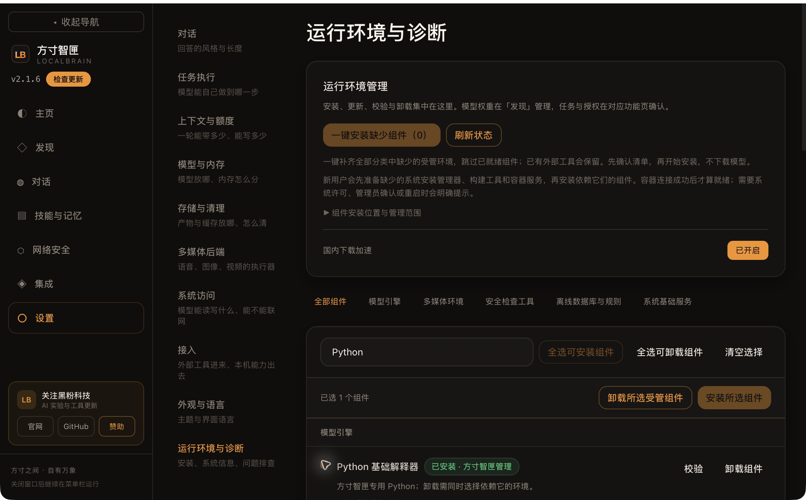

卸载也会立即交代原因。只选 Python 而没有选择依赖它的环境时，系统确认框会列出全部未选依赖，本轮实测显示四项；程序不擅自替你勾选，更不会直接删除。Docker 等系统程序继续先检测本地：已有环境复用，离线时提供启动，缺少才准备安装。系统共享组件保留原版本，不提供卸载。

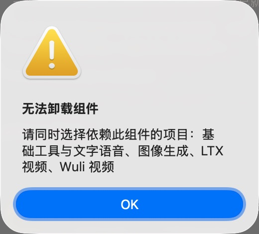

内核更新遇到的实际兼容差异是技能插件新增了工作目录服务。适配后只传递宿主已选的目录身份，工具调用仍回到方寸智匣的授权执行器。技能按需读取、完全关闭、中文增量摘要和旧会话恢复继续保留。

安装版使用已有 Splash 模型完成两轮、一次只读安全能力查询，实际读回 phase=2、dockerInstalled=true，没有扫描目标。随后点击“立即压缩”，持久日志记录了精简中文摘要、可信用户原文与真实回执，原始日志保留。另用旧版生成的会话升级恢复，验证工具只执行一次、不完整尾记录可以恢复；53 项内核回归在随包 Node 上通过，1632 项 TypeScript 与 14 项适配器测试通过，另有 2 项跳过。

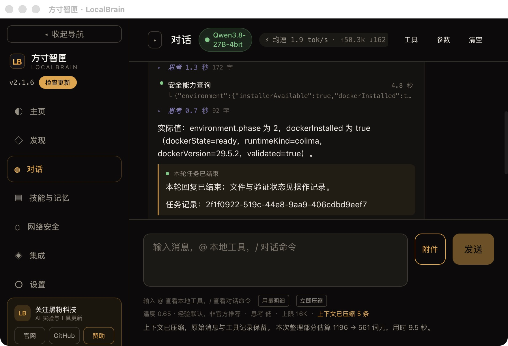

构建包、DMG、更新归档和安装应用的 13,984 个文件、权限与链接一致，应用及更新包签名通过，四处正式配置校验值未变。本轮没有下载模型，也没有卸载环境模拟新机。原生按钮、实际工具结果与压缩终态均已读回；临时验收会话和原始副本已移出正式资料库，证据只留本地。Mac 仍是本地签名、未 Apple 公证；全新 Mac、Windows/Linux 和真实 HTB 不属于本轮实测。

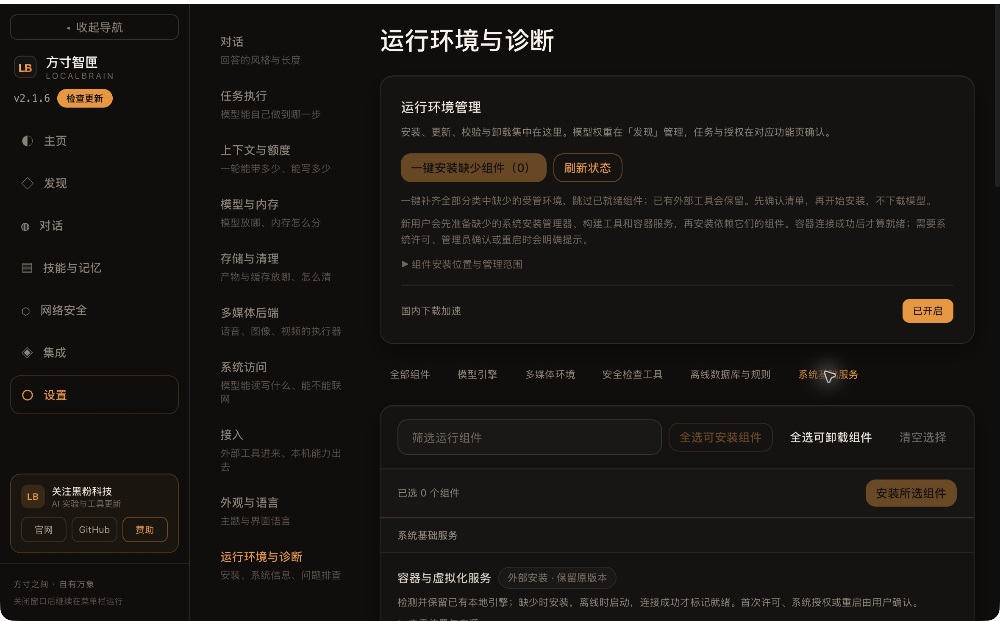

源码 GitHub 说明检查因账户付款／支出限制未启动；作者已于 2026-10-25 明确批准本次 Mac 2.1.6 例外发布。本地检查通过，不冒称远端 CI 通过。

[本轮验收与限制](VERIFICATION-2.1.6-MAC.md)。

## Mac 2.1.5：新用户依赖与容器服务统一准备

Mac 2.1.5 已正式发布，完成打包、安装及本轮原生界面验收；Windows/Linux 保留各自已发布的 2.1.3，由作者另行打包。

新用户打开“设置 → 运行环境与诊断”，点击“一键安装缺少组件”，核对清单后开始。程序先准备缺少的系统安装管理器、构建工具和容器服务，再准备依赖它们的环境。一项失败后停止后续，修复后重新补齐；已就绪组件会跳过。容器服务只有连接成功才标记就绪，已安装但离线时提供启动入口。

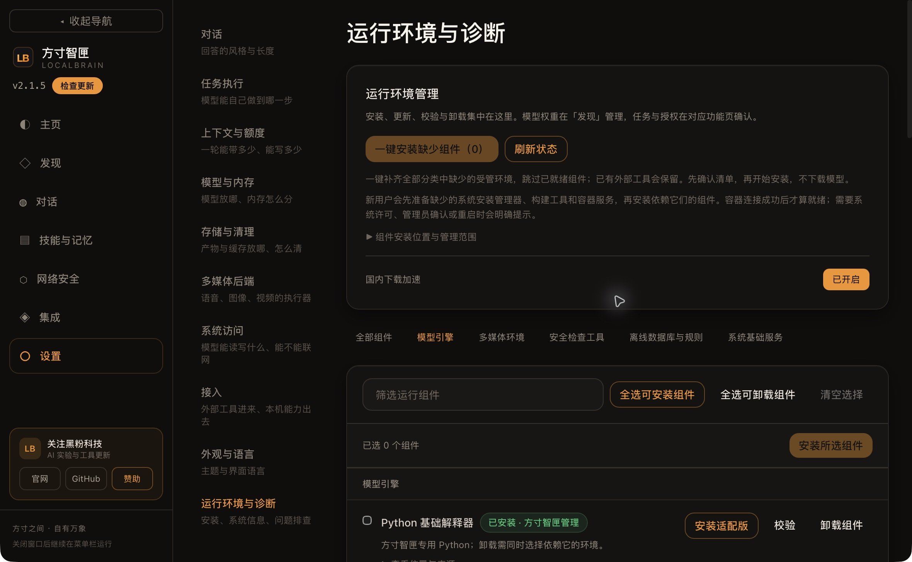

已有本地 Docker Desktop 或 Colima 会优先复用，保留默认连接、虚拟机资源参数和现有容器。系统共享组件不提供卸载；Python、FFmpeg、模型引擎和工具使用各自受管环境。Mac 缺少 Homebrew 时下载校验官方安装包，再交给系统安装器。首次许可、管理员授权和重启仍需用户确认。

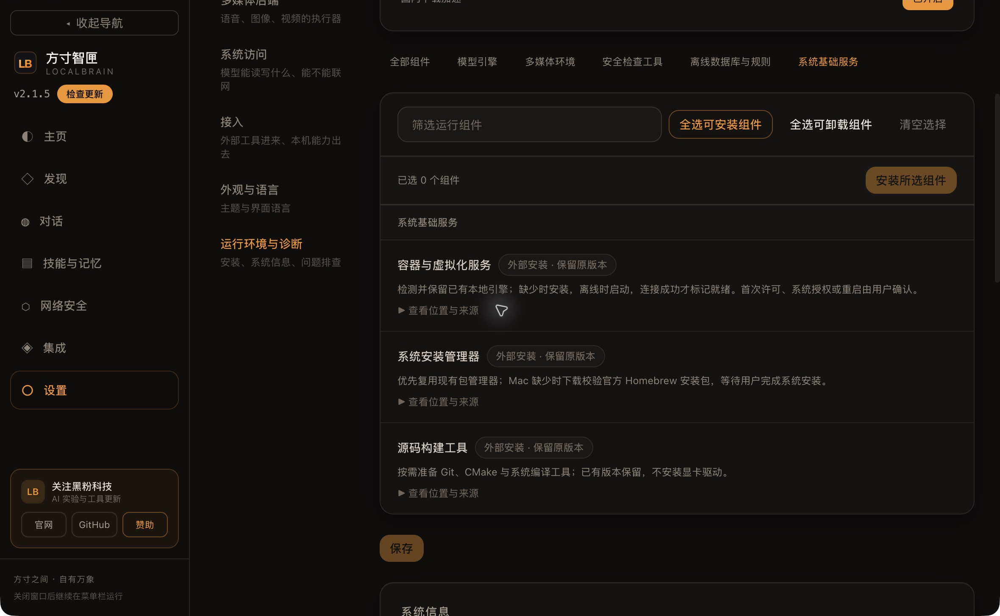

下载中可暂停并保留分片，恢复后显式继续；解压、pip 或容器步骤在当前组件完成后暂停后续。没有缓存显示下载，有分片显示续传，有完整归档显示使用缓存安装；只对确认已安装的受管组件显示卸载，有缓存才显示清理。内置文档、网页工具和 Harness 内核随软件更新，不再单列维护行。

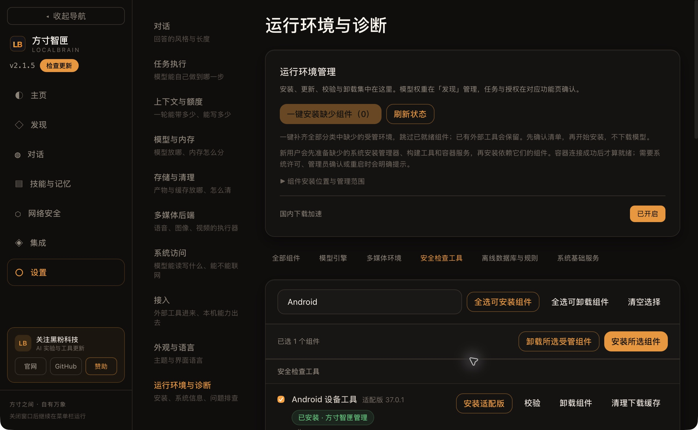

本轮安装版已核对五类组件、缺少项 0、三项系统依赖无卸载、筛选、批量选择、安装范围确认和取消。取消后未执行安装。此前构建、镜像、更新包与安装应用的 12,995 项文件及链接一致；应用及更新签名通过。真实复用已有环境、官方安装包下载/签名/缓存复用通过。无 Homebrew 全新 Mac、Windows/Linux 首次系统安装仍未实装验收；本轮没有卸载环境模拟新机，也没有下载模型或停止既有容器。

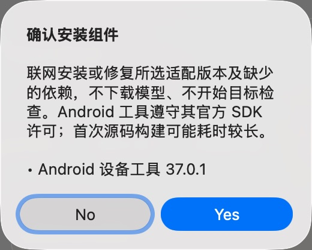

Mac 沿用本地签名，未 Apple 公证。源码仓 GitHub 说明检查因账户付款／支出限制未启动；作者已明确批准本次 Mac 2.1.5 例外发布；本地通过不冒称远端 CI 通过。详见[本轮验收](VERIFICATION-2.1.5-MAC.md)及[新用户依赖步骤](SYSTEM_PREREQUISITES_2.1.5.md)。

[下载 Mac 2.1.5 安装包（Apple Silicon DMG）](https://github.com/HackerChi-Hub/localbrain-releases/releases/download/v2.1.5/LocalBrain_2.1.5_aarch64.dmg)

## 历史候选记录：Mac 2.1.4 候选：一键补齐运行环境（待发布）

2026-10-25 候选修订增加运行环境暂停、待办恢复与显式继续，Splash 暂停保留原权重分片；下载、断点续传、使用缓存安装、卸载和缓存清理按实际状态显示。小文件与后台任务使用真实字节单位，暂停后撤下旧速度。官方约 25 MB 归档的准确偏移续传、完整校验、离线复用和清理已实测，未下载大模型。见[使用方式和验收边界](DOWNLOAD_CONTROLS_2.1.4.md)。下图为独立交互预览，安装/卸载明确模拟，清理后恢复下载按钮。正式安装包仍为 2.1.3。

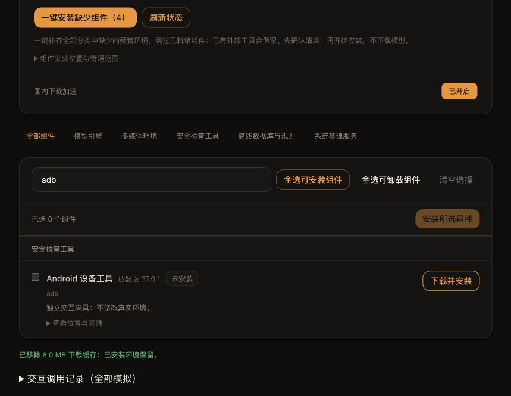

「设置 → 运行环境与诊断」只列模型引擎、多媒体、安全工具、离线数据及系统服务五组，内置文档、网页工具与 Harness 内核随软件更新，不再显示维护行。点「一键安装缺少组件」，确认依赖清单后自动补齐，跳过已就绪内容；专用容器上线后回读并复用已有镜像、数据库，失败后只重试仍缺少的项目。也可选择单项安装、更新与校验。

仅确认已安装的受管组件显示卸载，未安装、部分安装、外部和离线未知状态不提供删除；没有可卸载选择时不出现批量删除按钮。固定版本归档支持保留断流缓存、范围校验续传和完整 SHA-256 校验。系统依赖在现有官方包管理器支持范围内一键准备，系统许可、管理员确认与重启要求保留；已就绪系统服务不再显示多余安装说明。

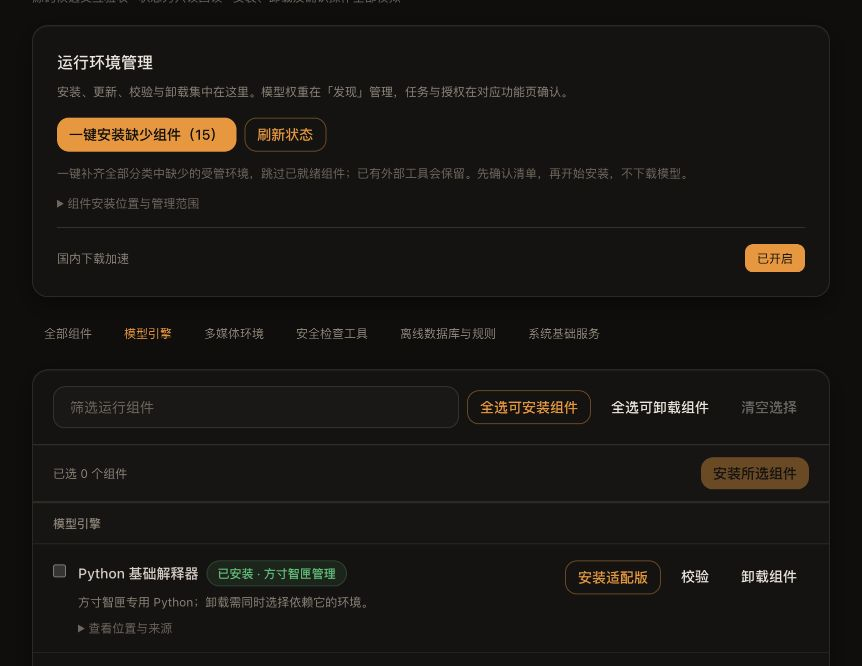

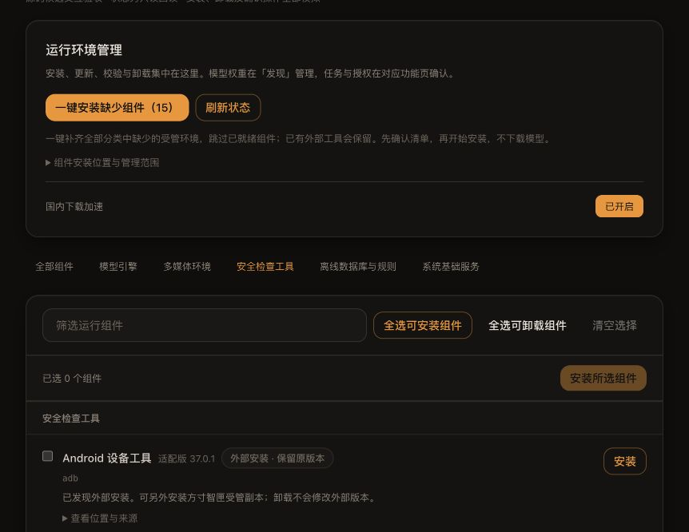

两张是同一生产组件的布局预览，使用只读库存和明确模拟的变更。修订包已安装，12,995 项文件及链接一致，签名与镜像检查通过；系统原生捕获仍失败，原生点选、全量容器准备与真实卸载未列为通过。见[验收边界](VERIFICATION-2.1.4-MAC.md)及[环境管理说明](RUNTIME_CENTER.md)。模型权重、外部工具、会话、报告与虚拟机保留。内嵌 Harness 仍为 0.2.0-rc.2。安装包仍待发布；Windows/Linux 保留 2.1.3。

Windows/Linux 2.1.3 已公开发布：Windows 修复版及 WSL2 Debian 已安装，Debian/AppImage 的资源、包内 DSH、20秒启动和53条DSH测试通过，三个安装包更新签名已验证。作者已明确批准本批源码 CI 账户限制例外；不冒称远端 CI 通过。Linux 裸机GPU和完整DSH图片/工具任务未验收，PolyStrata 35B的8K桌面超窗仍未解决。见[本批验收与待解决项](VERIFICATION-2.1.3-WIN-LINUX.md)和[正式下载](https://github.com/HackerChi-Hub/localbrain-releases/releases/tag/v2.1.3)。下方先前本机候选与单平台初发段落为历史记录，当前平台状态以本节为准。

## Windows 本机修复与 DSH 接入边界（2026-10-24）

接入页顶部已补回“一键恢复接入”，可集中撤销 Harness 完整接入与 Codex、Claude Code 的受管 MCP；各客户端分别报告锁定、冲突和无恢复点，保留原有配置。Windows 2.1.3 修复包已在本机安装，公开下载状态以下方分平台表为准。Linux 新包独立构建与验收，不借用 Windows 结果。

用户已确认 **Qwen3.8-2B-Distill Q4_K_M 在 DSH 的基础文本使用可用**。本机服务实际报告262144 token窗口，与导出配置一致；这不代表已验证填满后的速度、内存与长文质量，也不等于工具调用、多轮任务全部通过。当前2B端点不支持看图；图片理解、MCP图片显示与视觉模型接入需要分开验收。

**PolyStrata 35B 的完整 DSH 桌面请求在8K窗口仍会超限。** 截图显示系统提示约1.5K、工具定义约7.4K，两项已超过8K，另一次请求输入12728 token。仅压缩对话或降低输出上限不足以解决固定开销；需要按任务精简工具，或另测更大窗口。这是上下文预算问题，不能据此认定显存不足。此前适配器短请求通过，只证明连接与模型路由，不是完整桌面代理验收。

[待解决问题与验收边界](https://github.com/HackerChi-Hub/localbrain-releases/blob/main/KNOWN-ISSUES-DSH-LOCAL-MODELS.md)。GitHub 源码 CI 仍受账户限制，本地检查不冒充线上通过。

<!-- windows-performance:start -->
## Windows 2.0.1：小窗口任务与运行速度

针对本地模型的8K上下文，工具说明按需加载，短片段不反复摘要；压缩检查点附加真实工具回执的短记录，帮助模型识别已完成步骤。普通请求不增加常驻提示，原始记录保留，成果效果仍由用户判断。

2026-10-20，本机RTX 4070 Laptop 8GB显存、32GB内存，PolyStrata运行Qwen3.6-35B-A3B UD Q3_K_M：最近日志常见解码速度约75～90 token/秒，包含思考，不等于屏幕文字速度。以下是只读合成工具任务的单次耗时：

| 场景 | 旧版2.0.0 | 2.0.1（历史样本） |
| --- | --- | --- |
| 同轮双工具读取，未压缩 | 8.38秒 | 7.91秒 |
| 顺序读取，含一次压缩 | 未做同条件对照 | 19.70秒 |
| 失败后压缩、重试并结束，含两次压缩 | 未做同条件对照 | 31.66秒 |

这不是多轮性能基准；2.0.0也已包含部分优化，不能据此宣称相对未优化版稳定提速6%。压缩本身有耗时，最近一次摘要约5秒；减少重复执行可能节省整项任务时间，但尚未量化。五类真实模型回归及47条引擎测试通过，不代表所有任务都能完成，也不是原12题重测。见[测试方法与限制](PERFORMANCE-2.0.1-WINDOWS.md)。

以上为2026-10-20的历史测试样本；当前安装包与更新清单以上方/下方最新下载区为准。
<!-- windows-performance:end -->

<!-- evergreen:demos:start -->
## ▶ 使用演示

**本地模型启动、长任务与实际交付**

| Bilibili | YouTube |
| :---: | :---: |
|  |  |

视频演示的是拍摄时的版本；安装包与当前功能以本页正式发行信息为准。视频为中文讲解。
<!-- evergreen:demos:end -->

## 最新下载：Windows 2.1.7 · Mac 2.1.6 · Linux 2.1.7

以下 2.1.3 为历史工具接入验收记录。

Mac 2.1.3 恢复 Codex、Claude Code 的 MCP 一键工具接入，保留 DeepSeek Harness，不恢复 OpenCode。进入「集成」，按客户端复制、写入或单独撤销；只操作方寸智匣工具，保留模型、提供方、其它 MCP 和项目设置。配置默认收起，写入后在客户端新会话生效；桌面客户端运行时会提示先结束任务再退出，不自动关闭客户端。

已完成本机安装、12,995 个文件及链接一致性、签名及更新包独立验签，安装版 MCP 自检 26/26。Codex 实际调用文档工具通过；Claude Code 因登录凭据已撤销，按作者要求停测，不列为实际调用通过。Mac 使用临时签名、未 Apple 公证。GitHub 说明同步作业因账户限制未启动，作者明确授权本次 Mac 例外发布，本地通过不冒称线上 CI 通过。[本轮验收与限制](VERIFICATION-2.1.3-MAC.md)。Windows/Linux 继续使用 2.1.2，保留其原有验收。

以下 Mac 2.1.2 段落保留当时修复与验收记录。

Mac 2.1.2 已正式发布：修复只读程序资源引起的 MCP 安装失败，改为向受管 Python 环境注册并验证资源路径；每轮结束仅显示「赞助开发」文字，点击才展开二维码。网络安全名单全宽，连接与工具默认收起；按目标及连接类型显示表单，不再宣称 HTB 已支持。接入仅保留 DeepSeek Harness，另修复短任务耗时显示无穷倍数。已完成本轮本地回归、安装版针对性验收，以及 12,995 个文件与链接的一致性核对。GitHub 检查因账户付款／支出限制未启动，作者明确授权本次仅 Mac 例外发布，不将本地通过冒称线上 CI 通过。Windows/Linux 已补齐 2.1.2，详见下方验收。真实 HTB 闭环、原生安全执行批准及含待办操作的重启恢复仍未验收。[验收记录与限制](VERIFICATION-2.1.2-MAC.md)。

Mac 1.9.9修复下载终态及Sushi启动错误提示，包括状态刷新遮蔽内存原因的问题。最终安装版已验证真实预检拒绝、恢复32K后完整常驻加载与中文响应；同权重常驻／32 GiB精确SSD分别驻留44.20／31.21 GiB。模式手动选择，保存并重启生效，不自动降级。见[最终安装与实测范围](VERIFICATION-1.9.9-MAC.md)。下方1.9.8段落保留其当时验收边界。

2.0.8新增模型设置路径校验修复与网页CTF基础。网页传输6项在Windows/Linux通过，但生产隔离浏览器、原生批准和真实模型CTF完整链路仍未验收；须本平台隔离验证通过才能执行。[机制与限制](SECURITY-WEB-CTF.md)。

Windows/Linux 2.1.2 已补齐只读资源注册修复和本版界面改进。Windows 原生真实模型聊天、文件写入与压缩续答通过，已安装且配置哈希未变；Linux Debian/AppImage 的包内宿主、资源及 WSL2 启动检查通过，Debian 已安装。Linux 裸机/GPU及真实 HTB 未验收，特殊引擎不随应用隐式升级。 [2.1.2 verification](VERIFICATION-2.1.2-WIN-LINUX.md).

作者已批准本批 Windows/Linux 2.1.2 例外发布。GitHub 源码检查因账户付款／额度限制未启动，本地通过不冒充线上CI通过。

| 平台 | 安装包与状态 |
| --- | --- |
| Apple Silicon Mac 2.1.6 | [DMG](https://github.com/HackerChi-Hub/localbrain-releases/releases/download/v2.1.6/LocalBrain_2.1.6_aarch64.dmg) · 已安装，原生界面验收通过，已发布；系统依赖复用、确认与取消已核对；本地签名、未 Apple 公证 |
| Windows x64 | [安装程序](https://github.com/HackerChi-Hub/localbrain-releases/releases/download/v2.1.7/LocalBrain_2.1.7_x64-setup.exe) · 已安装；本批验收与限制见上方记录|
| Linux x64 | [Debian](https://github.com/HackerChi-Hub/localbrain-releases/releases/download/v2.1.7/LocalBrain_2.1.7_amd64.deb) · [AppImage](https://github.com/HackerChi-Hub/localbrain-releases/releases/download/v2.1.7/LocalBrain_2.1.7_amd64.AppImage) · 已安装；本批验收与限制见上方记录|

[Mac 2.1.6 发行说明](https://github.com/HackerChi-Hub/localbrain-releases/releases/tag/v2.1.6) · [Mac 校验值](SHA256SUMS-2.1.6-MAC.txt) · [Windows/Linux 2.1.6 发行说明](https://github.com/HackerChi-Hub/localbrain-releases/releases/tag/v2.1.7)。Mac 拖入应用程序；Debian/Ubuntu 执行 `sudo apt install ./LocalBrain_2.1.7_amd64.deb`。旧发行保留。

以下Windows 2.0.1及更早段落保留其发布时的历史状态；当前平台版本以上方下载表为准。

本次更新 **Windows 2.0.1**：压缩检查点附加最近3条程序原始回执短记录，帮助识别已完成操作；普通请求不增加常驻提示。有效压缩后，只有完整输出额度仍可容纳时才越过提前整理目标。真实模型故障注入、明确重做、失败重试、批量调用及最终包聊天/联网回归通过，本机已安装。摘要仍有损。见[验收与限制](VERIFICATION-2.0.1.md)。Mac保留1.9.9，Linux既有包不变。

以下为 1.9.1 的历史验收说明： 本轮上下文整理、技能与记忆的行为、实测与限制见 [1.9.1 验收记录](VERIFICATION-1.9.1.md)。原文与摘要分开保存，恢复不重执行已完成工具；摘要仍有损，可能遗漏事实。历史媒体实测见 [1.8.0 验收记录](VERIFICATION-1.8.0.md)，保留其语音、编辑、音乐和实验视频的问题说明。Windows、Linux Debian 已于 2026-10-17 从同一主分支提交补齐 1.9.1，启用原生工具引擎。Windows 包结构和更新签名通过；Linux 完成 WSL 安装及 20 秒启动检查。完整界面、模型和自动/手动摘要交互尚未在两平台实机验收；Linux 需手动安装 Debian 包，AppImage 自动更新保留 1.7.2。GitHub账户付款或支出限制使远端作业未启动，本地检查不冒充远端CI通过。

Mac 1.9.8 新增可选受管Sushi1.2.4：设置显式安装约71MB独立环境，发现页下载或挂载Qwen3.8 Flash Next 2.6位专用包。默认32K与完整常驻，可手动配置精确SSD预算；不依赖Homebrew，启动不更新引擎、不改系统代理和GPU内存限制。架构、分片和真实加载状态核对后才显示可用。本轮未重下125B权重，不把环境安装及跨域测试当作完整生成、速度或工具生成验收。见[使用说明](SUSHI_RUNTIME.md)与[Mac验收边界](VERIFICATION-1.9.8-MAC-SUSHI.md)。Windows1.9.8原有修复与验收保留，Linux发行不变。

## 安全能力与限制（2.0.7）

- 能做什么：在你显式授权的目标上，本地模型独立完成连接/响应头检查、网页暴露规则检测、服务识别、注入探测、TLS审计、目录发现与自写PoC验证，并导出逐字节可校验的检查报告。
- 授权约束：逐目标显式授权（单地址、最多8个端口、1–60分钟、内网单独确认）；模型不能建/扩授权，工具执行逐次原生确认，退出应用授权即失效。
- 破坏力接近零：每任务零路由内部网络，唯一出口是锁定授权端口的代理；容器降权只读无挂载；破坏性类别一律拒绝；改状态脚本二次确认。
- 不具备：漏洞利用框架、反向shell、提权、内网横向、完整CTF/HTB攻坚；需要VPN隧道的目标不可达；Windows/Linux隔离未实测、同样默认禁用。
- 法律边界在你：扫描任何不属于自己的系统须先获书面授权。

全文：[安全能力与限制说明](SECURITY-CAPABILITIES.md)

<!-- evergreen:screenshots:start -->
## 实际界面

下面沿用仓库中已公开的 1.4.6 版 macOS 截图，展示模型管理与工具接入布局；不是最新版本截图，模型与内存数字仅代表拍摄时的状态。

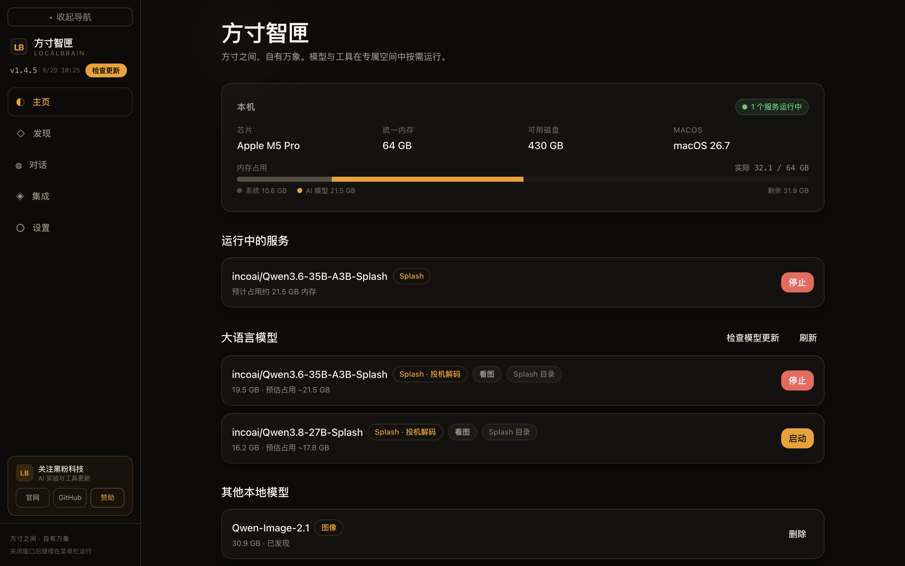

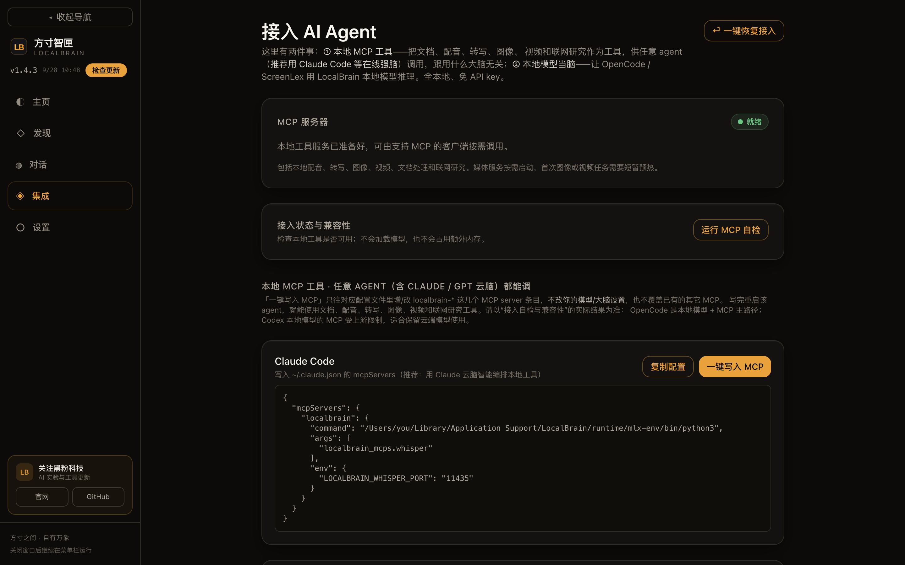
<!-- evergreen:screenshots:end -->

## 2.1.3 安装版工具接入

三客户端分别管理工具，示例默认收起；MCP 自检用于协议和工具发现，不代表每个媒体模型都已完成生成实测。截图来自最终安装版，顶部系统自动操作栏已裁除，原图留存本地。

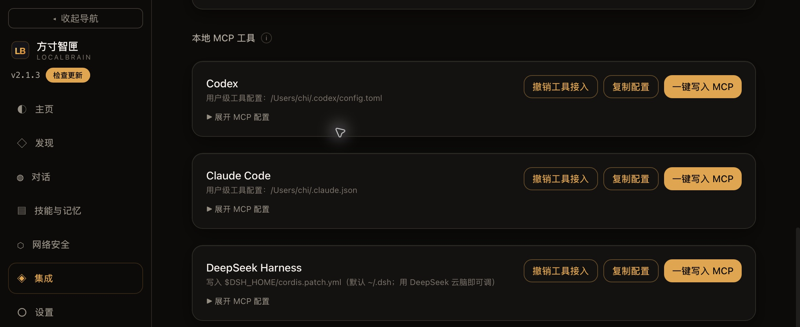

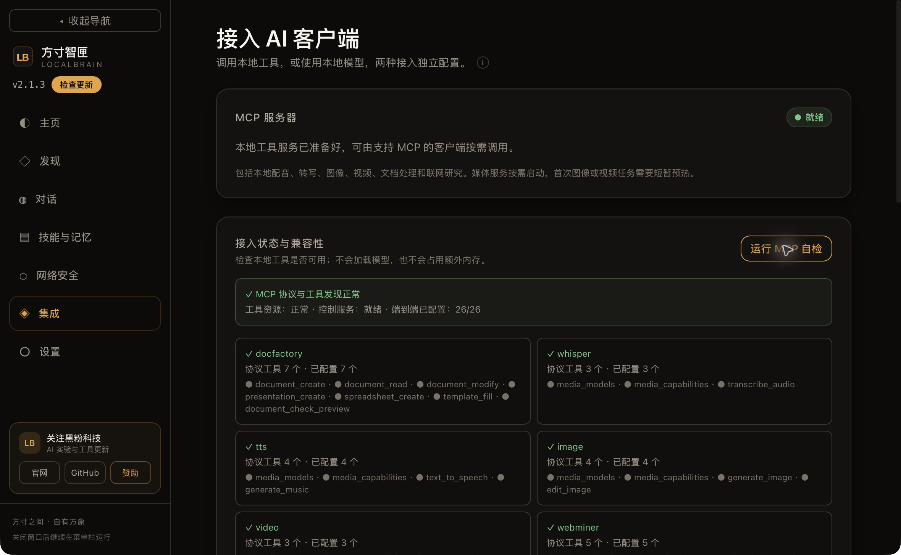

## 2.1.2 安装版网络安全页面

名单使用全宽，下方「连接与工具」默认收起；截图来自最终安装版，未添加测试目标，不代表真实 HTB 已连通。

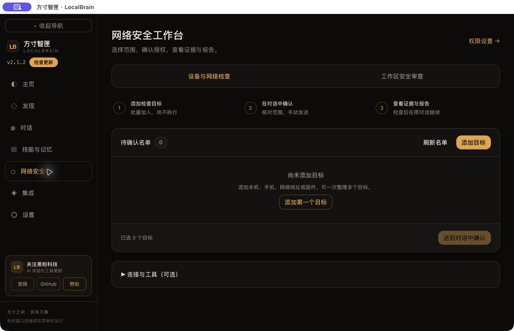

## 1.8.0 实际对话与下载页

以下为本机安装版实拍，顶部控制条已裁除；原始运行记录保留。下载页沿用同轮Wuli安装验收截图，对话为本轮媒体实测。

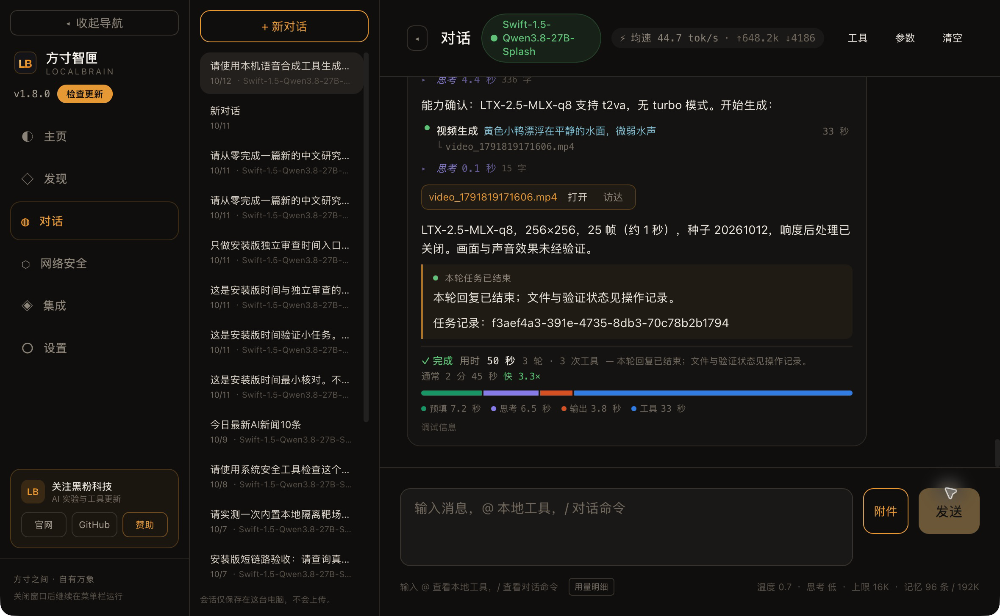

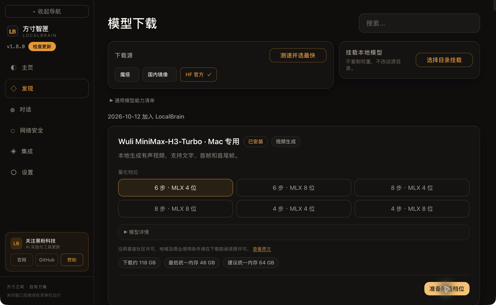

<!-- evergreen:capabilities:start -->
## 功能和使用

本地模型下载、导入、启停；流式对话、附件、思考控制、硬件感知上下文预算与任务恢复；已授权文件、项目构建测试、文档和网页工具；已集成模型的语音、图片、视频、音乐工作台；MCP、本地模型接口、存储管理和三语界面。媒体详细参数依模型能力，不保证所有模型支持笑声、精确停顿或多参考图。

1. 启动支持工具调用的模型，进入设置的网络安全入口。
2. 选择内置练习靶场、自己的主机或服务、自己的容器。
3. 选择目标和模型检查／直接检查，核对范围并确认。
4. 环境自动准备，模型以原生批准调用工具并读取证据；维护默认折叠。

只检查自己拥有或明确获授权目标。主机授权绑定实际地址和端口，不扩展至其他目标；覆盖连接与响应头、网页暴露规则、服务识别、注入探测、TLS审计、目录发现与授权自写脚本，不是无限制漏洞扫描或自动利用平台。项目工作目录限制不等于系统沙箱，镜像审计不等于运行中应用的完整评估。

## 平台与隐私

Mac支持已集成MLX、Metal llama.cpp、Splash与Prism；Windows使用适配llama.cpp/Prism，不支持MLX/Splash。Linux近期新增预览，受管llama.cpp/Prism下载未完整接入，不支持MLX/Splash。构建成功不代替真机验收。

本地推理不要求对话上传云端；下载、依赖、更新、网页与外部服务仍可能联网。应用不捆绑模型权重，模型许可证独立。
<!-- evergreen:capabilities:end -->

## SHA-256

| 文件 | 散列 |
| --- | --- |
| Mac DMG | `5a52f1d0c240e3957d6b62a634267289d3e4d150309f0aa332a026c7466cb776` |
| Windows安装程序 | `304b9d00203c8cdf94ba7bf210510ee764a01d61f6c67f60a3eeb1e902141a43` |
| Linux AppImage | `dd51274347276752e36ec42fb9e6fc208387ba08693ad67cf4d6ac0faa76a859` |
| Linux Debian包 | `07e0d22feab9f4b8d34832bfe3e79832f4b628eefb8bbc8947e6d79e82aee06d` |

本仓提供安装包与说明，不是开发源码目录。专有软件，© HyphenTech · 黑粉科技。

<!-- evergreen:use-cases:start -->
## 适合哪些人

| 需求 | 方寸智匣怎样帮助你 |
| --- | --- |
| 在 Mac 上部署本地大模型 | 集中管理已集成引擎和模型，不必分别维护多个桌面入口 |
| 让 AI 处理本地文件 | 选择支持工具调用的模型，授权工作范围，核对执行回执 |
| 用 AI 做办公与媒体任务 | 文件、文档、语音、图片、视频和音乐工作台按已集成模型能力使用 |
| 把本地模型接入其他工具 | 使用本地模型接口与 MCP 集成，兼容性以客户端和模型能力为准 |

## 第一次使用

1. 按系统下载安装包，打开后选择适合硬件的模型与引擎。
2. 下载或导入模型并启动，先完成一次普通对话。
3. 处理文件时选择支持工具调用的模型，明确授权范围，再核对真实结果。

模型权重需要另行下载，安装包不包含模型。语音、图片和视频功能取决于已集成模型，不能把一个模型的能力套用到所有模型。

## 常见问题

**本地 AI 能离线使用吗？** 已准备好运行环境和模型后，本地推理可以留在电脑上；下载、依赖、更新、网页及主动连接外部服务仍需要网络。

**Windows 和 Linux 也能运行 MLX 吗？** 当前 MLX 与 Splash 集成为 Mac 专属；Windows 使用适配的 llama.cpp / Prism，Linux 为预览支持。安装包构建通过不等于对应系统已完成所有实机验收。

**能代替办公排版验收吗？** 可以读取、编辑并预览已支持的文件；完整模型主导办公任务仍待验收，公式重算需要相应环境，渲染截图也不能代替人工排版检查。

**安装遇到提示怎么办？** Mac 包未完成苹果公证，请核对官方来源与校验值后按系统提示允许打开；Windows、Linux 按对应安装包说明操作。
<!-- evergreen:use-cases:end -->

<!-- evergreen:discovery:start -->
## 黑粉科技自制软件

按需求选用，也可以组合使用：本地模型交给方寸智匣，云端接口交给黑粉盒子，录制教程用黑粉录屏，影视英语学习用光影词库。

| 软件 | 适合解决的问题 | 官方下载 |
| --- | --- | --- |
| 方寸智匣 LocalBrain | 本地大模型、文件与媒体工作台 | [下载方寸智匣](https://github.com/HackerChi-Hub/localbrain-releases) |
| 黑粉录屏 HyphenScreen | 屏幕录制、教程剪辑、字幕与动画 | [下载黑粉录屏](https://github.com/HackerChi-Hub/HyphenScreen-Releases) |
| 光影词库 ScreenLex | 看电影学英语、字幕查词、生词复习 | [下载光影词库](https://github.com/HackerChi-Hub/screenlex-download) |
| 黑粉盒子 HyphenBox | 免费 AI API 发现、模型核验与统一接口 | [下载黑粉盒子](https://github.com/HackerChi-Hub/hyphenbox-release) |

## 分享与反馈

分享给朋友时，请复制本仓库首页或[官方网站](https://hyphentech.top)，让对方按自己的系统下载当前安装包。欢迎收藏仓库、点亮 Star，或在本仓库 Issues 提交使用体验、需求和脱敏问题。

关注[哔哩哔哩「黑粉科技」](https://space.bilibili.com/1846717524)、[YouTube 黑粉科技频道](https://www.youtube.com/@hyphentech_top)；公众号和视频号搜索「黑粉科技」，查看实际演示与使用教程。
<!-- evergreen:discovery:end -->
